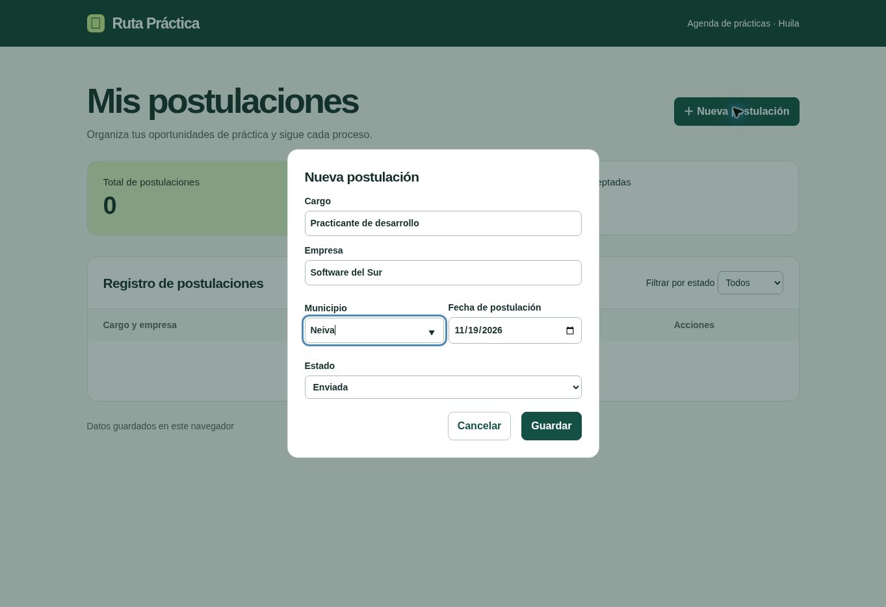
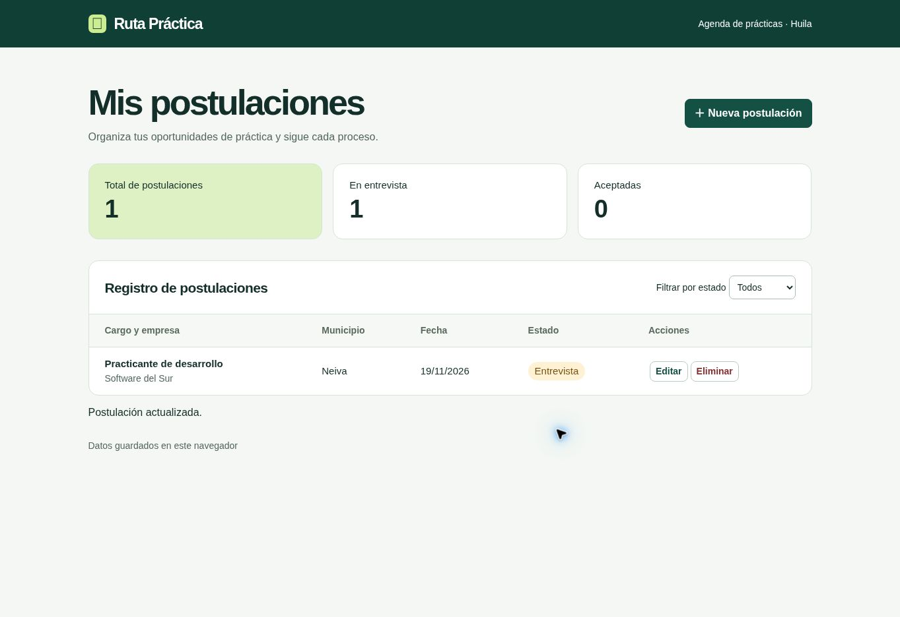
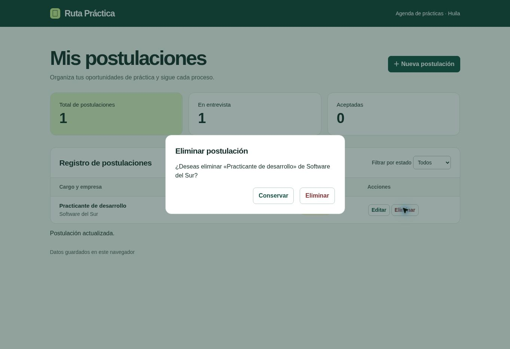

# Ruta Práctica

Agenda para que un estudiante registre sus postulaciones a prácticas profesionales en el Huila. Permite crear, consultar, editar y eliminar registros y filtrar por estado. Los datos se conservan al recargar la página en el mismo navegador.

**Seminario:** Gestión de Software Ágil Asistido por IA · Fundación Escuela Tecnológica de Neiva (FET).  
**Estudiante:** Juan Sebastián Aranda. **Docente:** Camilo Morales Vargas.

## Ejecutar en Windows

1. Descarga y descomprime el proyecto. Abre una terminal en la carpeta que contiene `index.html`.
2. Con Python 3 instalado, ejecuta `py -m http.server 8000 --bind 127.0.0.1`. En macOS o Linux usa `python3` en lugar de `py`.
3. Abre **http://localhost:8000** en Chrome o Edge. Usa siempre la misma dirección y puerto para recuperar tus registros. Para detener el servidor, presiona Ctrl+C.
4. Si usas Visual Studio Code con Live Server, también puedes abrir `index.html` con **Open with Live Server**. Esa dirección tendrá su propio almacenamiento.

## Código y datos

| Archivo | Función |
|---|---|
| `index.html` | Estructura de la agenda, formulario de alta y edición, diálogo de eliminación. |
| `estilos.css` | Presentación, estados visuales y adaptación a pantallas pequeñas. |
| `app.js` | Eventos del formulario, validación, operaciones CRUD, filtros y persistencia. |
| `proceso/app-inicial.js` | Primera versión funcional, anterior a la refactorización. El sitio carga la versión final de la raíz. |
| [Guion del video](GUION.md) | Secuencia para grabar la explicación y la demostración con tu voz. |

La aplicación usa HTML, CSS y JavaScript sin dependencias. Guarda un arreglo de objetos como JSON en la clave `rutaPractica.v1` de localStorage. Cada objeto contiene `id`, `cargo`, `empresa`, `municipio`, `fecha` y `estado`. El ID se conserva al editar. La agenda empieza vacía y cada navegador mantiene su propia copia. Usa datos ficticios para las demostraciones.

## Prueba del CRUD

| Acción en pantalla | Resultado que debes observar |
|---|---|
| Crear «Practicante de desarrollo», empresa «Software del Sur», Neiva, estado Enviada. | Aparece una fila y el total sube a uno. |
| Recargar el navegador. | La misma fila sigue en la tabla. |
| Editar esa fila y seleccionar Entrevista. | El total sigue en uno y el indicador de entrevistas pasa a uno. |
| Elegir Eliminar y después Conservar. | La fila permanece. |
| Confirmar Eliminar y recargar. | La fila sigue ausente y el total vuelve a cero. |

## Capturas de la ejecución

**Crear una postulación**  

**Leer el registro creado**  

**Actualizar y comprobar el contador**  

**Confirmar la eliminación**  

## Desarrollo guiado por IA

Herramienta utilizada: ChatGPT con Codex. La consigna del seminario inició el desarrollo. Durante la preparación se enviaron las siguientes instrucciones a un asistente de IA. El estudiante puede reproducir el proceso en una copia y documentar sus propias decisiones en el video.

**1. Definir los datos y las pruebas.**

> Diseña el modelo de datos y el flujo CRUD de una agenda de postulaciones a prácticas del Huila con HTML, CSS, JavaScript y localStorage. Propón una primera implementación legible de la función de guardado y un caso de prueba por operación. Responde en español. No escribas archivos.

Se pidió una función de persistencia y una prueba por operación. La propuesta usó un identificador estable y convirtió la lista a JSON. En la implementación, `guardar()` actualiza la tabla después de que la escritura tiene éxito y avisa si falla. Se eligieron municipios del Huila y se conservaron campos editables para otras localidades.

**2. Revisar y mejorar la primera versión.**

> Revisa RutaPractica/app.js y el formulario. Propón una refactorización concreta para simplificar la validación y un ajuste para que una postulación recién creada sea visible incluso con un filtro activo. Indica qué probar. No edites archivos.

La revisión sugirió extraer `leerFormulario()` y volver a «Todos» cuando un filtro ocultaría una nueva postulación. Se incorporaron ambos cambios. Si el filtro es compatible, se conserva. Para ver la diferencia abre `proceso/app-inicial.js` y `app.js` con la opción de comparación de tu editor.

## Video y entrega

La grabación personal está pendiente. Al terminarla, sustituye esta frase por el enlace de visualización del video. Comprueba en una ventana privada que se abren el repositorio y el video. El único enlace que entregas al profesor es el de este README en GitHub.
